<div align="center">

# Women on Boards Awards 2026<br>AI-Powered Evidence Assessment & Ranking System

**A production retrieval-augmented generation (RAG) system that turns nomination evidence into cited, human-verified, provisional rankings for an awards committee.**

<br>


<br><br>


</div>

---

## Contents

1. [Summary](#summary)
2. [The problem and the outcome](#the-problem-and-the-outcome)
3. [Screenshots](#screenshots)
4. [Architecture](#architecture)
5. [How it works, step by step](#how-it-works-step-by-step)
6. [Key design decisions](#key-design-decisions)
7. [Responsible AI and data protection](#responsible-ai-and-data-protection)
8. [Technology stack](#technology-stack)
9. [Quality and engineering practice](#quality-and-engineering-practice)
10. [Getting started](#getting-started)
11. [Repository layout](#repository-layout)
12. [For hiring managers and recruiters](#for-hiring-managers-and-recruiters)

---

## Summary

The **Women on Boards (WOB) Awards** recognise women in corporate governance across eleven award categories, from *Woman Executive Leader of the Year* to *Rising Star in Corporate Governance*. Every year a committee has to compare shortlisted finalists fairly, using CVs, nomination forms, supporting documents and public records.

This system does the reading, cross-checking and first-pass scoring, and leaves the decisions to people:

- **It builds a private evidence base for each finalist.** Uploaded documents are virus-scanned, OCR'd where needed, split into passages and indexed for both meaning and keywords.
- **It extracts factual claims** (roles, achievements, outcomes) and checks every quoted sentence against the source document.
- **It researches public sources.** Claude searches the web for registries, regulators and organisation websites that confirm or contradict each claim, and evidence for each award criterion.
- **It proposes a rating for every finalist on every criterion**, citing the passages it relied on. Citations that can't be verified are discarded.
- **Reviewers approve or adjust each rating**, and the system produces provisional rankings, PDF deliberation reports and a judges' pack.

> **AI rankings are advisory.** The committee retains responsibility for deliberation and winner approval. The system is designed so that every number traces back to quoted evidence and a named human decision.

The system implements the *AI-Powered RAG Technical Specification v1.0* and runs in production, where it was used for the 2026 awards.

---

## The problem and the outcome

| Before | With this system |
|---|---|
| Judges read hundreds of pages per category by hand, under time pressure | Evidence is indexed once; every rating comes with the passages that justify it |
| Claims in nominations were taken on trust or checked ad hoc | Each claim is linked to its source quote; public sources are found and verified automatically |
| Scoring varied between judges, with no audit trail | A versioned, frozen rubric; every AI rating, human adjustment and decision is audit-logged |
| Comparing finalists meant spreadsheets and email | Deterministic rankings, tie detection, PDF reports and a judges' pack in one place |

**In production:**
- **Research at scale:** 456 public-source findings were accepted automatically under the credibility rules.
- **Claim linking:** 113 research findings were linked to the claims they support, across 68 candidates.
- **Rule changes absorbed in days:** a change of rating scale (1–5 to 0–3), a jury ruling on supporting documents, and new nomination-form evidence.

---

## Screenshots

> All screenshots use a separate demo database with **placeholder nominees and organisations** (Nominee Candidate1, Organisation A, and so on). No real nomination data is shown.

<table>
<tr>
<td width="50%"><b>Dashboard</b>: progress of the evidence pipeline and the top-ranked finalists across categories.<br><br>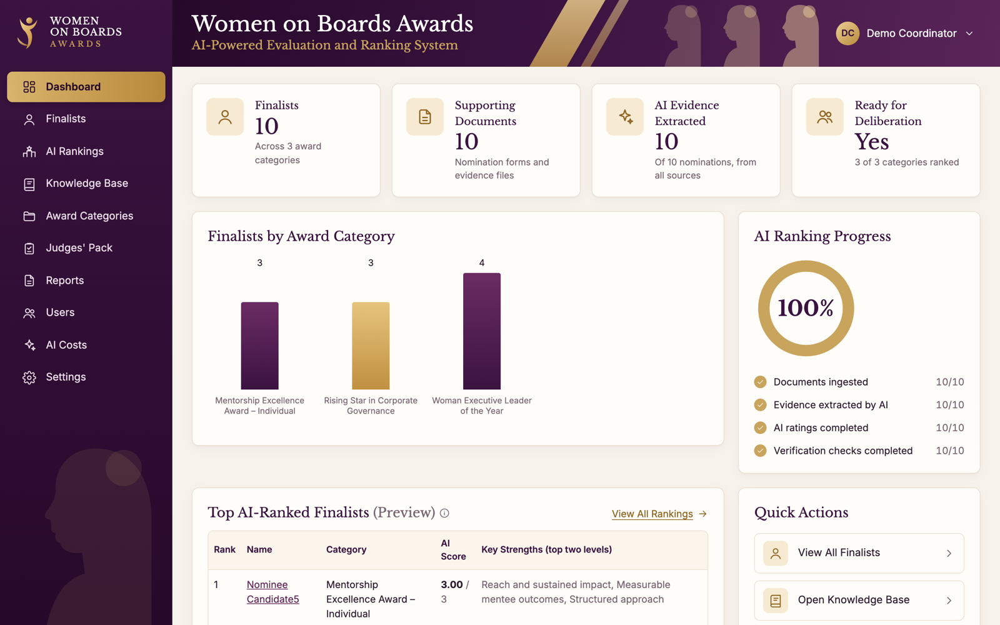</td>
<td width="50%"><b>Finalist evidence summary</b>: ratings per criterion, overall score on the rubric's scale, and evidence sources.<br><br>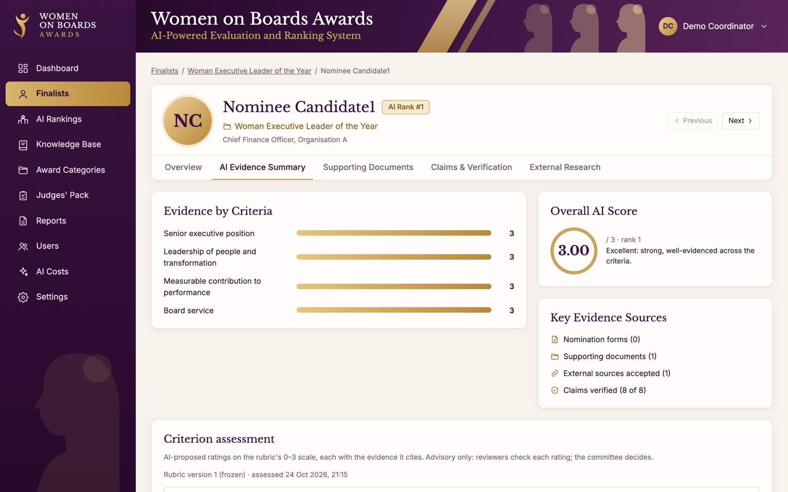</td>
</tr>
<tr>
<td><b>Claims and verification</b>: every claim quotes its source; supporting documents verify claims under the jury's rule.<br><br>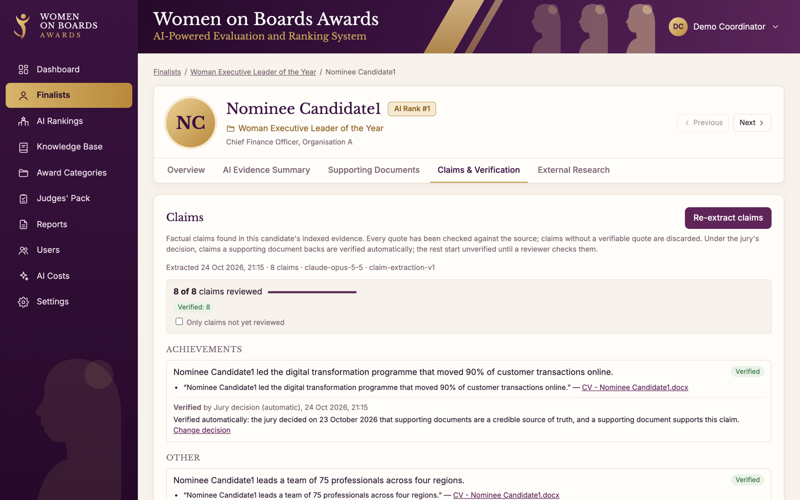</td>
<td><b>External research</b>: public sources found by Claude, quote-checked against the fetched page, accepted automatically when credible.<br><br>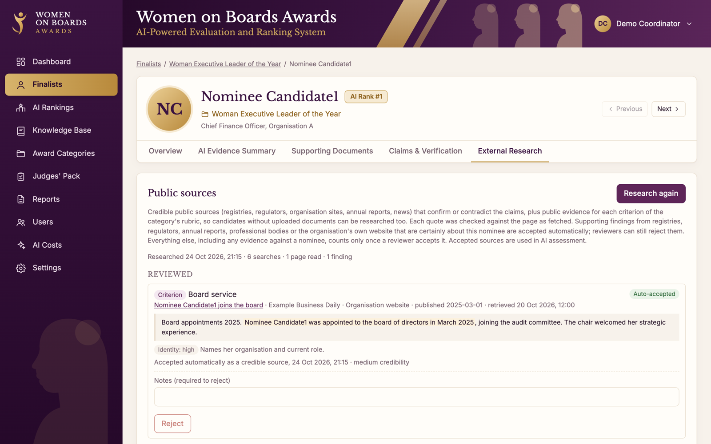</td>
</tr>
<tr>
<td><b>Provisional ranking</b>: deterministic scores on a frozen rubric, tie and close-result detection, ratings per criterion.<br><br>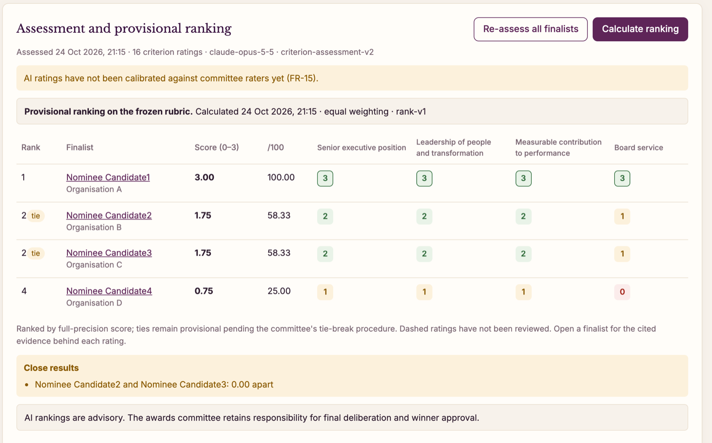</td>
<td><b>Judges' pack</b>: each category's top three finalists with their reports and documents.<br><br>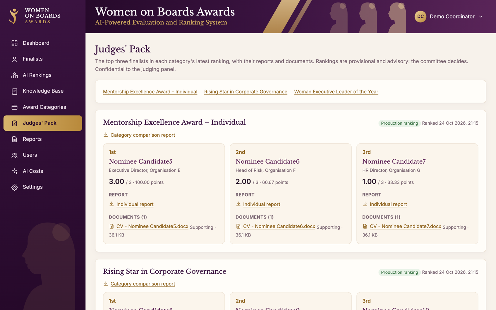</td>
</tr>
<tr>
<td><b>AI costs</b>: estimated spend per pipeline step from recorded token and search usage.<br><br>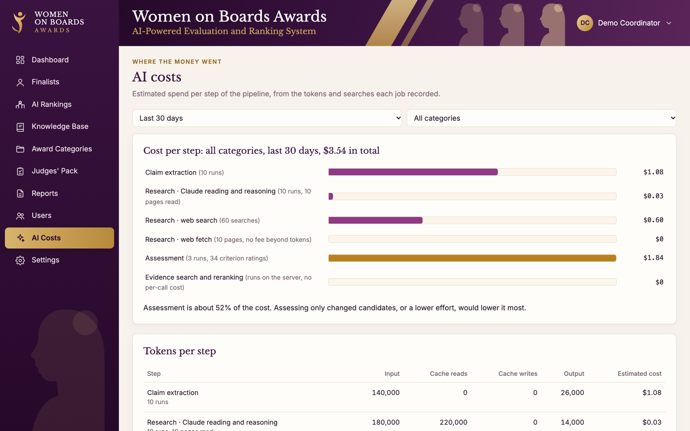</td>
<td><b>Knowledge base</b>: all indexed evidence, searchable and filterable by category, finalist and type.<br><br>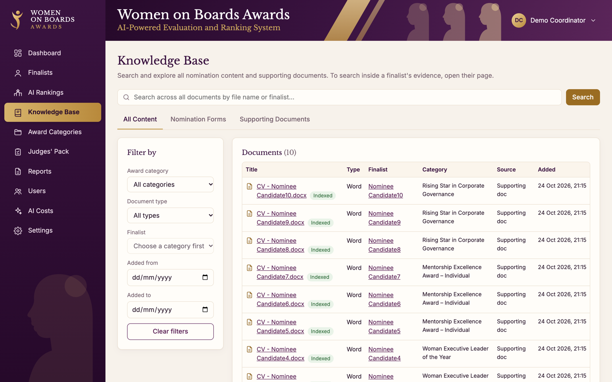</td>
</tr>
</table>

---

## Architecture

### System architecture

A single DigitalOcean server runs the whole stack in Docker. Only Caddy is reachable from the internet; everything else talks over an internal network.

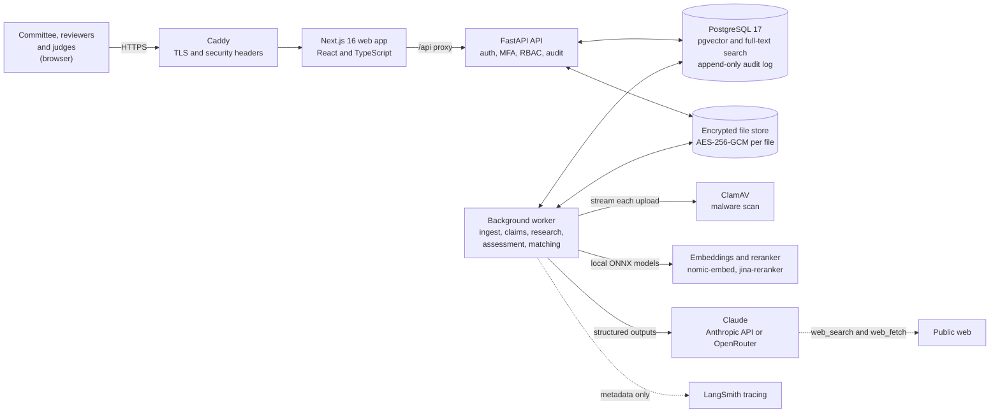

### The RAG pipeline

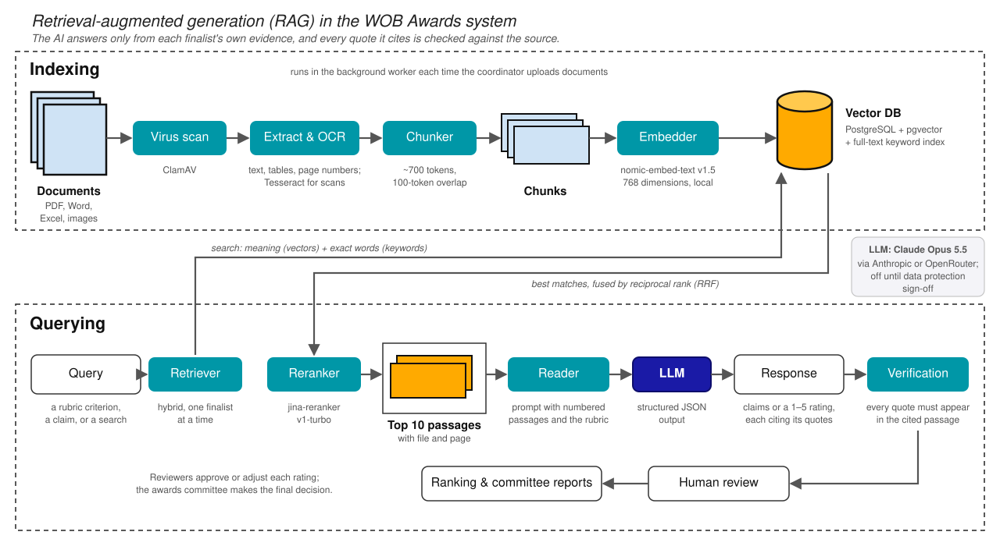

### Assessing one criterion

How a single rating is produced. The AI never sees another finalist's evidence, and nothing it says counts until it is verified and reviewed.

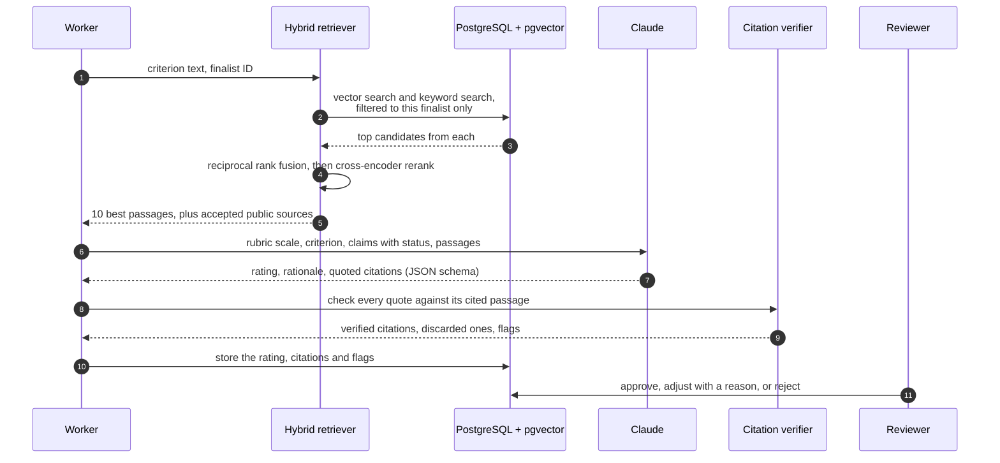

### Data model at a glance

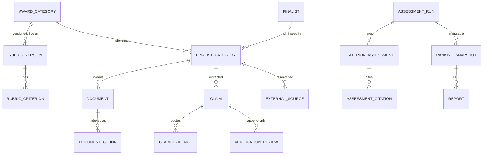

---

## How it works, step by step

| # | Step | What happens | Who |
|---|---|---|---|
| 1 | **Set up the category** | Coordinators create award categories and a rubric: criteria, evidence expected, weights, and the rating scale (0 None, 1 Poor, 2 Good, 3 Excellent). The committee approves and freezes it; a frozen rubric can't change. | Coordinator, committee |
| 2 | **Shortlist and record consent** | Finalists are added with their consent: assessment, AI processing, and public-web research are recorded separately and enforced. | Coordinator |
| 3 | **Collect evidence** | CVs and supporting documents are uploaded, or nomination-form exports are imported (contact details stripped). | Coordinator |
| 4 | **Ingest** | Each file is streamed through ClamAV, extracted (with Tesseract OCR for scans), split into ~700-token passages and embedded locally. Passages are indexed in pgvector and Postgres full-text search. | Worker |
| 5 | **Extract claims** | Claude lists the factual claims the evidence makes, each with exact quotes. Quotes that aren't in the passage are discarded. Claims backed by a supporting document are verified under the jury's ruling; the rest go to a reviewer. | Worker, reviewer |
| 6 | **Research public sources** | Claude searches the web and fetches pages. A finding is kept only if its quote appears in a page fetched in that run. Supporting findings from registries, regulators or the organisation's own site, about this nominee, are accepted automatically and linked to the claims they support. | Worker |
| 7 | **Assess** | For every finalist × criterion: hybrid retrieval, reranking, a Claude rating with citations, and mechanical citation checks. Uncited ratings above the lowest level can't be approved. | Worker |
| 8 | **Review** | Reviewers approve, adjust (with a reason) or reject each rating. Rejected ratings count as missing, not zero. | Reviewer |
| 9 | **Rank** | A deterministic score (mean or weighted mean) per finalist, competition ranks, ties and close results flagged. Snapshots are immutable. | Coordinator |
| 10 | **Report and deliberate** | PDF category and individual reports with cited evidence and questions for judges; the judges' pack collects the top three per category. | Committee, judges |
| 11 | **Calibrate (optional)** | Committee members rate the same items blind; quadratic-weighted kappa compares the AI with them and with each other. | Committee |

---

## Key design decisions

- **Evidence isolation.** Retrieval filters to one finalist inside both searches, and re-checks every returned passage. Cross-finalist evidence would be an integrity failure, so it raises an error rather than a warning.
- **Verify, don't trust, the model.** Claims, research findings, assessment citations and claim links are all quote-checked against the exact source text. The model proposes; deterministic code decides what counts.
- **Structured outputs everywhere.** Every Claude call returns JSON against a Pydantic schema, constrained to the rubric's rating scale.
- **Hybrid retrieval.** Dense vectors (nomic-embed, local ONNX) plus Postgres full-text search, merged by reciprocal rank fusion and reranked by a local cross-encoder. Names, dates and figures that embeddings miss are still found.
- **The database is the last line of defence.** Frozen rubrics, append-only audit and review tables, immutable rankings, rating-scale checks and consent rules are enforced by PostgreSQL triggers and constraints, not only by application code. A privileged, audited path exists for data-protection purges.
- **Human decisions are first-class data.** Every review stores who, when, why and what changed. Automatic decisions (the jury rule, credible-source acceptance) record their basis and can always be overturned by a person.
- **Versioned everything.** Rubrics, prompts, the retrieval configuration and the ranking calculation all carry versions, so a report from last week can be explained exactly.
- **Operability.** Background jobs are idempotent and resumable (`FOR UPDATE SKIP LOCKED` queues with retries), and deploys run the catch-up commands automatically. Per-container memory caps keep one service from taking the server down.

---

## Responsible AI and data protection

The system processes personal data about nominees, so data protection shaped the design from the start. A data protection review against Uganda's Data Protection and Privacy Act 2019 is in [`docs/operations/data-protection-review.md`](docs/operations/data-protection-review.md).

- **Consent in three parts** (assessment, AI processing, web research), enforced at every step that needs it.
- **Least privilege.** Role-based access for admin, secretariat, committee, reviewer and judge. Invitation-only accounts with TOTP two-factor authentication for privileged roles.
- **Encryption at rest.** Every stored file has its own data key (AES-256-GCM envelope encryption). Deleting a file destroys its key.
- **Retention and erasure.** Per-category retention dates, a purge that crypto-shreds files and redacts audit details, and subject-access exports.
- **Minimisation.** Imported forms drop emails, phone numbers and dates of birth before anything reaches the AI. LangSmith tracing is metadata-only, enforced in code and covered by a test.
- **Blind calibration.** Raters in an open calibration study can't see AI ratings, rankings or reports for that category.
- **Advisory by design.** Every screen, report and ranking says the committee decides; practice rankings on unfrozen rubrics are labelled as such.

---

## Technology stack

| Layer | Technologies |
|---|---|
| **AI** | Claude Opus 5.5 (claims, assessment, matching), Claude Haiku 5.5 (web research), Anthropic API with server-side web search and fetch, OpenRouter support, structured JSON outputs, adaptive thinking |
| **Retrieval** | PostgreSQL 17 + pgvector, Postgres full-text search, reciprocal rank fusion, `nomic-embed-text-v1.5` and `jina-reranker-v1-turbo-en` via FastEmbed (ONNX, on the server) |
| **Backend** | Python 3.12, FastAPI, SQLAlchemy 2, Alembic (18 migrations), Pydantic, a background worker, ReportLab PDFs, Tesseract OCR, ClamAV |
| **Frontend** | Next.js 16, React, TypeScript, accessible custom UI with light and dark themes |
| **Security** | Argon2id passwords, TOTP MFA, HttpOnly SameSite sessions, RBAC, AES-256-GCM file encryption, Caddy-managed TLS |
| **Observability** | LangSmith (metadata-only traces), an AI cost dashboard, a structured audit log |
| **Infrastructure** | Docker Compose, Caddy, DigitalOcean, image builds off-server, an SSH deploy script |
| **Tooling** | uv, pytest, Ruff, TypeScript compiler, Git and GitHub |

---

## Quality and engineering practice

| Measure | Value |
|---|---|
| Automated tests | **225+**, against a real PostgreSQL + pgvector database rebuilt from migrations on every run, downgrades included |
| Application code | ~14,600 lines of Python, ~6,800 lines of TypeScript |
| Test code | ~6,400 lines |
| API endpoints | 73, documented via OpenAPI at `/docs` |
| Database migrations | 18, each reversible |

- **AI calls are tested without calling the AI.** Scripted model doubles exercise the full pipelines: prompt contents, schema handling, quote verification, retries, refusals and failure recovery.
- **Behaviour the database enforces is tested at the database level:** frozen rubrics, append-only tables, rating scales and consent rules.
- **Privacy guarantees have tests:** no contact details in imported documents, no prompt or output text in traces.
- **Commits are small and explained.** Each change ships with tests and documentation.

---

## Getting started

Requires Docker, [uv](https://docs.astral.sh/uv/) and Node.js.

```bash
cp .env.example .env          # set POSTGRES_PASSWORD, both database URLs and SECRET_KEY
make db-up                    # PostgreSQL + pgvector on 127.0.0.1:5432
make migrate                  # apply the schema
make user EMAIL=you@org NAME="Your Name" ROLE=admin   # prints a set-password link
make test                     # rebuilds the test database and runs the suite
make api                      # API on http://127.0.0.1:8000 (OpenAPI docs at /docs)
cd frontend && npm install && cd ..
make web                      # web app on http://localhost:3000
make worker                   # ClamAV + background worker
```

AI features stay off until `LLM_PROVIDER`, an API key and `EXTERNAL_AI_PROCESSING_APPROVED=true` are set (see `.env.example`). Production runs with `infrastructure/deployment/deploy.sh`.

The full behaviour, every rule and every operating command are in the **[technical reference](docs/technical-reference.md)**.

---

## Repository layout

```
backend/          FastAPI app, worker, services, Alembic migrations (SQL), 225+ tests
frontend/         Next.js web app (App Router, TypeScript)
ai/               prompts, rubrics, output schemas and the retrieval evaluation set
infrastructure/   Docker Compose for development and production, Caddy, deploy script
docs/             technical reference, data protection review, architecture images, screenshots
```

---

## For hiring managers and recruiters

**What this project is:** a complete, production AI system, built and run end to end, for a real organisation with real deadlines, real personal data and a committee that has to stand behind its decisions.

**My role.** I led the project from specification to production:

- **Product and requirements:** translated the client's technical specification (v1.0: functional requirements, schema, API and acceptance tests) into a working system, then adapted it as the client's rules changed. That meant a new rating scale, a jury ruling on evidence, new award criteria, and nomination forms arriving mid-cycle.
- **Architecture:** designed the RAG pipeline, the per-finalist evidence isolation, the verification-first approach to model output, and the database-enforced governance model.
- **AI engineering:** prompt and schema design, hybrid retrieval and reranking, quote-verified citations, credible-source rules for web research, calibration statistics, cost tracking and privacy-safe tracing.
- **Full-stack delivery:** FastAPI backend, background worker, PostgreSQL schema and migrations, and a Next.js interface for coordinators, reviewers, the committee and judges.
- **Security and data protection:** consent model, RBAC and MFA, file encryption, retention and erasure, and a data protection review under Uganda's DPPA 2019.
- **Operations:** deployed and ran it on DigitalOcean. That included diagnosing a production outage (memory exhaustion during on-server builds), then moving builds off the server and adding per-container limits.

**How it was built.** I used Claude Code as an AI pair programmer throughout. I set the direction, made the design and governance decisions, worked with the client on their rules, reviewed and tested the changes, and operated the system in production. Using AI tools well, with tests, verification and clear accountability, is itself part of the engineering this project demonstrates.

**Skills demonstrated:** retrieval-augmented generation · LLM application engineering (Claude, structured outputs, tool use) · vector and hybrid search · Python and FastAPI · PostgreSQL design · TypeScript and Next.js · testing strategy · security and privacy engineering · cloud deployment and incident response · working with non-technical stakeholders.

### Concluding remarks

Most AI demos stop at "the model gave an answer". This project is about everything that has to be true before an organisation can **rely** on that answer:
- the evidence is the right person's;
- every quote is real;
- every score is reproducible;
- every decision is attributable to a person;
- personal data is handled lawfully;
- the system keeps running when the requirements change in the final week.

That combination of AI capability, engineering discipline and responsibility is what I bring to a team.

<div align="center">

**Samuel Mugisha** · [github.com/samuelmugisha](https://github.com/samuelmugisha)

</div>
